# Neurite FluoroQuant

Neurite FluoroQuant is a Fiji plugin for high-throughput, semi-automated analysis of fluorescent neurites. It works with Fiji 1.53d and newer and accepts most standard image file formats. Images can be 2D or 3D (Z-stacks) but must be static (no time series).

You assign a **Region of Interest (ROI) channel** and an **Analysis channel**, trace the neurite of interest, and the plugin runs the analyses you choose.

## Contents

- [Key features](#key-features)
- [Installation](#installation)
- [Workflow overview](#workflow-overview)
- [Step-by-step guide](#step-by-step-guide)
  - [1. Input / output selection](#1-input--output-selection)
  - [2. Analysis mode](#2-analysis-mode)
  - [3. General settings](#3-general-settings)
  - [4. Output metrics settings](#4-output-metrics-settings)
  - [5. ROI selection](#5-roi-selection)
  - [6. Background subtraction tuning](#6-background-subtraction-tuning)
  - [7. Mask threshold tuning](#7-mask-threshold-tuning)
  - [8. Analysis](#8-analysis)
  - [9. Patch detection](#9-patch-detection)
- [Batch mode](#batch-mode)
- [Reference](#reference)
  - [Output files](#output-files)
  - [Numerical readouts](#numerical-readouts)
  - [Patch detection tuning parameters](#patch-detection-tuning-parameters)
  - [Example tuning values](#example-tuning-values)

## Key features

- **Two complementary analysis modes.** Quantify fluorescence signal and sub-cellular structures *within* a neurite, or directly *adjacent* to it (e.g. synaptic contacts onto a dendrite).
- **Binary mask gating.** A mask generated from the ROI channel ensures measurements are taken precisely within the neurite of interest, not the surrounding neuropil.
- **2D and 3D support** across three workflows:
  - 2D single-plane image analysis
  - "Sub-stack" Z-projections, for Z-stacks acquired from thin tissue samples
  - Tracing across multiple Z-planes with automated stitching and Z-depth compensation, for neurites in thick tissue samples
- **Interactive tuning with live previews** for the mask, background subtraction and fluorescent "patch" (puncta) detection, so you can optimise parameters before analysis runs.
- **Wide range of measurements:** fluorescence intensity along the whole neurite, neurite length and width, signal unevenness (coefficient of variation), and intensity and morphology of detected patches (punctate signal such as synaptic terminals, boutons, or fluorescent dyes loaded into synaptic vesicles).
- **Batch mode** reuses all settings from the previous run after ROI selection, enabling high-throughput analysis of large datasets. Summary outputs can optionally be appended to a master CSV file, so you don't need to copy and paste results into one spreadsheet.

## Installation

1. Download `Neurite FluoroQuant.ijm` from this repository.
2. Copy it into the `plugins` folder of your Fiji installation (`Fiji.app/plugins/`).
3. Restart Fiji, or select **Help › Refresh Menus**.
4. Run the plugin from the **Plugins** menu.

## Workflow overview

The plugin follows a simple linear workflow. Each step corresponds to one dialogue box.

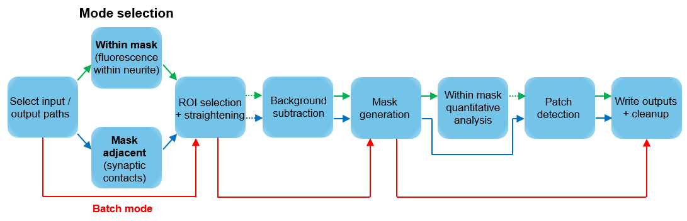

## Step-by-step guide

### 1. Input / output selection

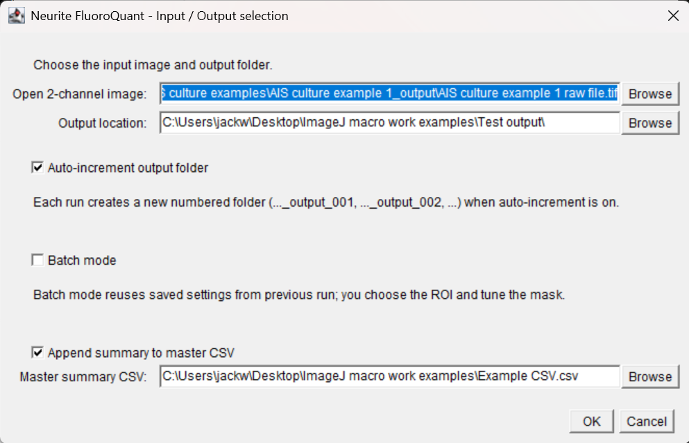

Select the input file and an output folder. The output folder and all output files are named after the input file, with a suffix added for each analysis output.

- **Auto-increment output folder** adds a sequentially numbered suffix, so the same file can be analysed multiple times without changing the output location or file name. For example, repeated runs on `FILE_NAME.tif` produce `FILE_NAME_output_001`, `FILE_NAME_output_002`, and so on.
- **Batch mode** retains all settings from the previous run after ROI selection and mask tuning. This is useful for analysing a large batch of images acquired with consistent imaging settings. See [Batch mode](#batch-mode).
- **Append summary to master CSV** writes all recorded summary metrics to a CSV file at the end of each run. To use it, save a blank `.csv` file in a folder of your choice, tick the checkbox, and point the file box to that spreadsheet. Each subsequent run is written to a new row.

### 2. Analysis mode

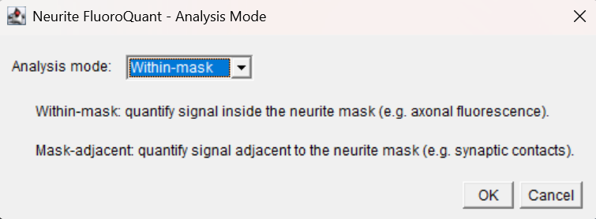

Choose one of two analysis workflows:

- **Within-mask mode** quantifies the fluorescence signal and morphology of the neurite of interest, as defined by mask thresholding, followed by optional detection of sub-cellular structures within the neurite.
- **Mask-adjacent mode** detects putative synaptic contacts onto the neurite of interest. This can be performed in up to two synaptic marker channels.

### 3. General settings

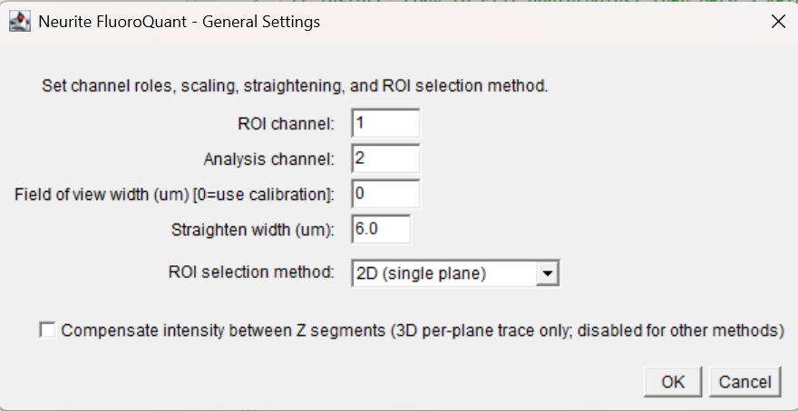

- **ROI channel** and **Analysis channel** assign channel roles. The ROI channel is where you draw the segmented line ROI. The Analysis channel is where most analysis is performed. The plugin can also compute metrics from the ROI channel (see [Output metrics settings](#4-output-metrics-settings)). The two do not need to be separate: ROI selection and analysis can be performed on a single channel.
- **Field of view width** sets the scale calibration (pixels : µm). Set it to `0` to use the scale stored in the file metadata, which suits images from most modern imaging systems.
- **Straighten width** is the width of the straightened image generated after ROI selection.
- **ROI selection method** chooses one of three ROI selection workflows, described in [ROI selection](#5-roi-selection).
- **Z-compensation** (optional) is only applied when the *3D (per-plane trace)* workflow is selected. See [3D (per-plane trace)](#3d-per-plane-trace).

### 4. Output metrics settings

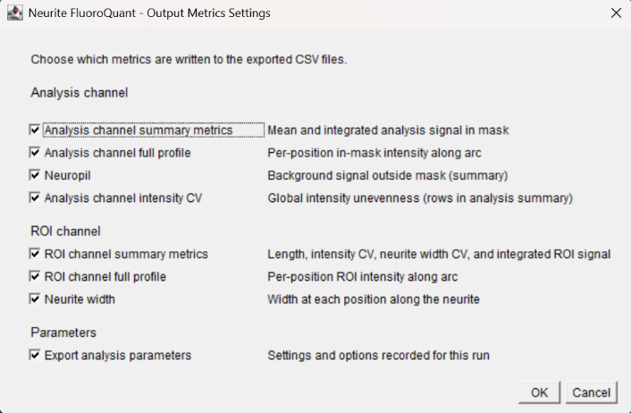

Choose which outputs are written for each channel. Analysis parameters (e.g. channel assignment, straighten width) can also be exported. All metrics are exported as `.csv` files. Each output is described in [Output files](#output-files) and [Numerical readouts](#numerical-readouts).

### 5. ROI selection

ROI selection uses one of three methods, chosen in the General settings dialogue. The method only affects this step: all downstream analysis is the same whichever method you choose.

#### 2D (single plane)

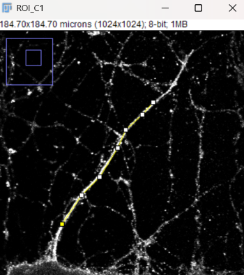

Used for all single-plane images, and the most straightforward method. Draw a segmented line over the neurite of interest in the ROI channel: right-click the line tool in ImageJ, select **Segmented Line**, draw the ROI, and accept once complete.

#### 3D (Z-range projection)

The simpler of the two methods for Z-stacks. It generates a Z-projection from a range of sections that you define.

First, choose the Z-projection method (here, *Max Intensity*):

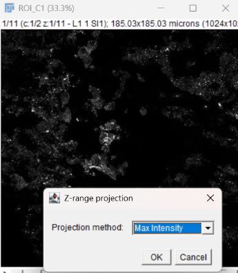

Then scroll to and select the first and last Z-sections that contain the neurite of interest. A 2D projection is created from those sections, and ROI selection proceeds as in the 2D (single plane) workflow.

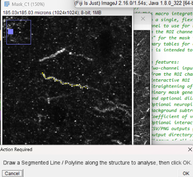

> [!NOTE]
> We only recommend this method for Z-stacks covering a relatively small tissue volume from thin samples. In our example datasets, this was a maximum Z-stack thickness of 10 µm from 50 µm sections.

#### 3D (per-plane trace)

Suitable for neurites in thicker tissue that travel extensively through the Z-axis. You reconstruct the neurite by drawing a segmented line ROI separately in each Z-plane. The segments are then straightened and automatically aligned into one continuous straightened image. A full example workflow is shown below.

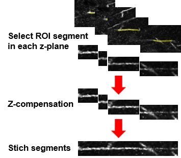

During each subsequent ROI selection, a green cross marks the final point of the previous ROI. Start the next ROI exactly there for the best alignment.

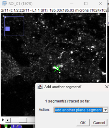

**Z-compensation** can be turned on in the General settings dialogue to correct for signal drop-off as the neurite goes deeper into the tissue. It scales the intensity of every segment to match the brightest segment. The panel below shows the same dendrite reconstructed with and without Z-compensation.

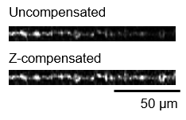

### 6. Background subtraction tuning

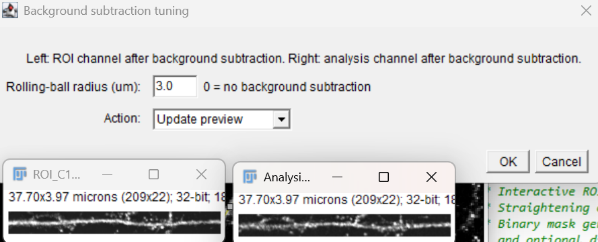

Once ROI selection is complete, a straightened image of the neurite is generated. Interactive background tuning lets you optimise image quality for downstream analysis. **Update preview** regenerates both channels with the chosen background subtraction value applied. Select **Accept and continue** to proceed.

> [!NOTE]
> Background subtraction is optional. Set the value to `0` to skip it.

### 7. Mask threshold tuning

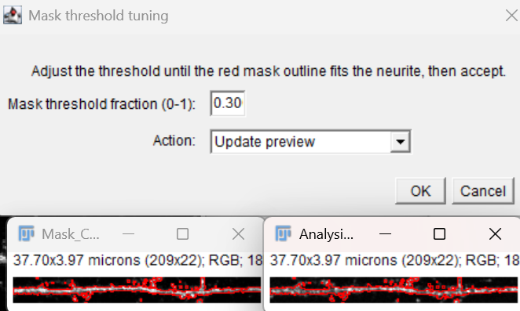

Mask threshold tuning works the same way as background subtraction. A binary mask is generated containing everything within the red lines, and this mask filters all further analysis.

> [!IMPORTANT]
> In within-mask mode, all further analysis is carried out only on pixels inside the mask, in both the ROI and Analysis channels. Optimising this step is critical to getting the most out of the plugin.

The panel below shows how increasing the threshold affects the mask. A higher threshold gives a more restrictive mask, so fewer pixels are included in the analysed structure.

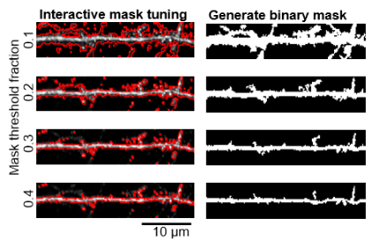

### 8. Analysis

- **Within-mask mode:** analysis runs now. All selected metrics are calculated and written to the output folder as CSV files.
- **Mask-adjacent mode:** this step is skipped.

### 9. Patch detection

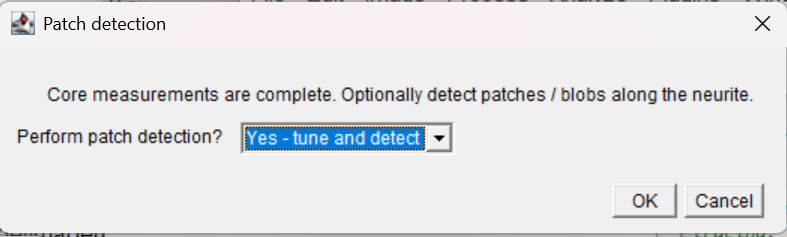

- **Within-mask mode:** patch detection is optional. **No – skip** ends the run; **Yes – tune and detect** proceeds to patch detection.
- **Mask-adjacent mode:** patch detection is required, so the dialogue above is skipped.

In both modes, patch detection finds punctate "patches" of fluorescence, but each mode does it slightly differently.

#### Within-mask patch detection

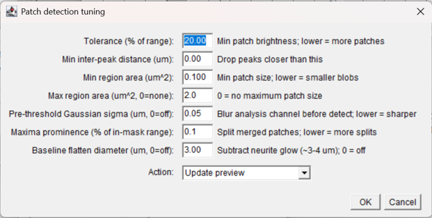

Patches are detected in the Analysis channel and restricted to the neurite of interest. This is useful for detecting sub-cellular structures, such as synaptic boutons along axons. The example below shows detected patches outlined in yellow.

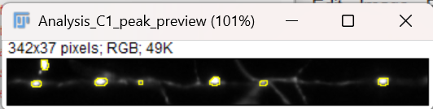

#### Mask-adjacent patch detection

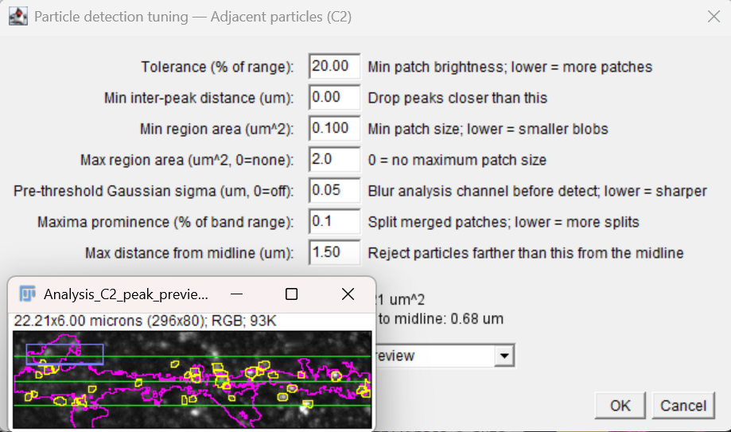

Works like within-mask detection with one major difference: detection is **not** confined to the neurite, which makes it suitable for detecting putative synaptic contacts onto the neurite. The tuning dialogue adds a **Max distance from midline** parameter, which rejects patches further from the midline than the specified distance. This distance is shown by the green lines in the preview; all patches outside the lines are rejected.

Mask-adjacent detection can run in up to two analysis channels if a second channel was assigned in General settings. Each channel is tuned individually.

Once tuning is complete, select **Accept and continue**. Outlined patches are quantified with Fiji's *Analyze Particles* function and the values are written to the output folder. The plugin then closes all its windows and finishes the run.

See [Patch detection tuning parameters](#patch-detection-tuning-parameters) for a description of each parameter, and [Example tuning values](#example-tuning-values) for starting points.

## Batch mode

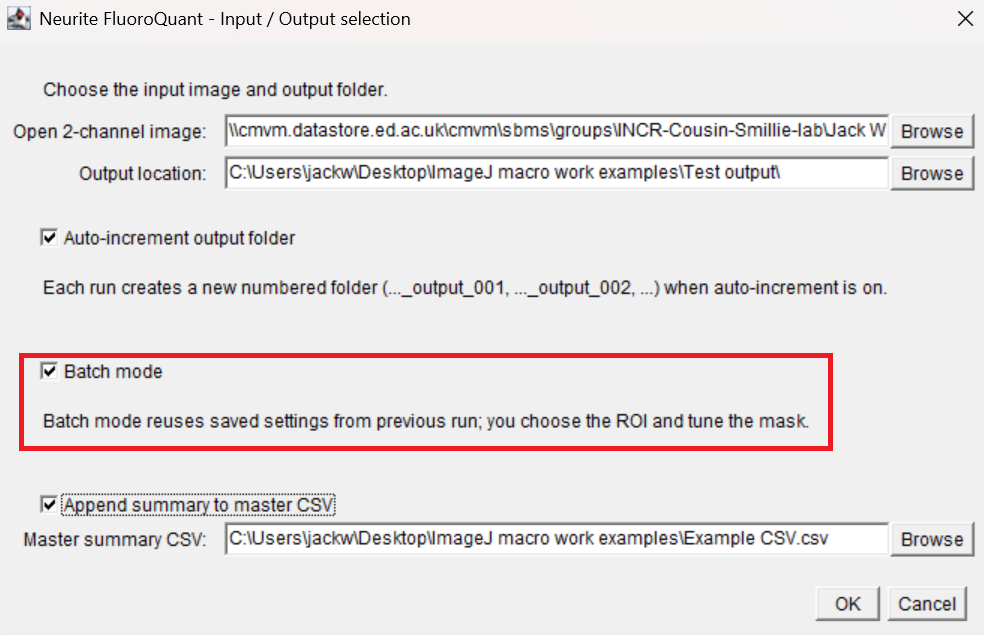

For high-throughput processing of large datasets, tick **Batch mode** in the Input / output selection dialogue on any run after the first. Batch mode reuses all settings from the previous run, except ROI selection and mask tuning, which still need your input. All other steps are skipped. Combined with **Append summary to master CSV**, entire datasets can be processed and written to a single summary spreadsheet very quickly.

## Reference

### Output files

| Output | Folder | Description |
|---|---|---|
| Mask PNG | ROI channel | Image of the mask generated from the traced neurite. |
| ROI straight PNG | ROI channel | Straightened image of the ROI channel. |
| ROI summary CSV | ROI channel | Neurite length; mean and integrated ROI channel fluorescence intensity (raw and background-subtracted); fluorescence intensity coefficient of variation (CV); mean neurite width; and neurite width CV. |
| ROI profile CSV | ROI channel | ROI channel fluorescence intensity at each X-position along the neurite (raw and background-subtracted). |
| Neurite width CSV | ROI channel | Neurite width (measured from the mask) at each X-position along the neurite. |
| Analysis straight PNG | Analysis channel | Straightened image of the analysis channel. |
| Overlay PNG | Analysis channel | Straightened analysis channel image overlaid with outlines of detected patches. Only written if patch detection was performed. |
| Merged overlay PNG | Analysis channel | Merge of the straightened images from two analysis channels, overlaid with the mask skeleton and outlines of detected patches in both channels. Only written in mask-adjacent mode with two analysis channels. |
| Analysis summary CSV | Analysis channel | Mean and integrated analysis channel fluorescence intensity (raw and background-subtracted); fluorescence intensity CV; and, if patch detection was performed, patch count, density, and mean size, intensity and shape (circularity). |
| Analysis profile CSV | Analysis channel | Analysis channel fluorescence intensity at each X-position along the neurite. |
| Patches CSV | Analysis channel | Full measurements (area, intensity, diameter, circularity, position along / across the neurite) for each detected patch. Only written if patch detection was performed. |
| Neuropil summary CSV | Analysis channel | Mean fluorescence intensity outside the mask, and in-mask enrichment relative to that. Useful for comparing signal within the neurite against background. |
| Analysis parameters CSV | Parameters | All selected parameters: channel assignments, pixel-to-µm calibration, straighten width, mask threshold, rolling-ball background subtraction value, and (if used) patch detection settings. |

### Numerical readouts

| Readout | Description |
|---|---|
| Neurite length | Total length of the user-drawn segmented line (µm). |
| Neurite width | Mean neurite width (µm), calculated from the width of the mask. |
| Fluorescence intensity | Mean intensity of all pixels within the mask. Reported raw and background-subtracted (`bgsub`). |
| Projection integrated intensity | Sum of all within-mask pixel intensities along the neurite. Reported raw and background-subtracted. |
| CV (coefficient of variation) | Standard deviation / mean. Reported for analysis and ROI channel fluorescence intensities, and ROI channel width. |
| Patch count | Number of fluorescent puncta detected (if patch detection is performed). |
| Patch density | Patch count / total mask area (patches / µm²). |
| Linear patch density | Patch count / neurite length (patches / µm). |
| Patch mean area, intensity, diameters, circularity | Patch size (µm²), fluorescence intensity and shape. Circularity of 1 is a perfect circle; higher values are more circular. |
| Neuropil mean | Mean intensity of pixels in the straightened analysis channel image that lie outside the mask. Reported raw and background-subtracted. |
| Corrected intensity | Fluorescence intensity (within mask) − neuropil mean (outside mask). |
| Enrichment | Fluorescence intensity / neuropil mean. |

### Patch detection tuning parameters

| Parameter | Analysis mode | Description |
|---|---|---|
| Tolerance (% of range) | Both | Fluorescence intensity filter. Higher value = fewer patches. |
| Min inter-peak distance (µm) | Both | Minimum distance between two adjacent patches; closer patches are rejected. Set to `0` to switch off. |
| Min region area (µm²) | Both | Minimum size of accepted patches. |
| Max region area (µm²) | Both | Maximum size of accepted patches. |
| Pre-threshold Gaussian sigma (µm) | Both | Noise filter that merges speckles as the value increases. Higher value = fewer, larger patches. |
| Maxima prominence (% of band range) | Both | Split threshold for two conjoined patches. Lower value = more splits; higher value = fewer splits. |
| Baseline flatten diameter (µm) | Within-mask only | Baseline correction for the underlying neurite fluorescence. |
| Max distance from midline (µm) | Mask-adjacent only | Maximum distance from the midline for accepted patches. Shown by green lines in the preview. |

### Example tuning values

| Experimental scenario | Min. size (µm²) | Max. size (µm²) | Dist. to nearest patch (µm) | Tolerance threshold (%) | Gaussian sigma (µm) | Maxima prominence (%) | Baseline correction (µm) | Max. dist. from midline (µm) |
|---|---|---|---|---|---|---|---|---|
| Fluorescent dye loading into synaptic vesicles (within-mask mode) | 0.5 | 10 | 0 | 10 | 0.5 | 10 | 3 | NA |
| Fluorescent bouton detection along axons (within-mask mode) | 0.5 | 10 | 0.5 | 20 | 0.5 | 1 | 3 | NA |
| Excitatory synaptic contacts onto dendrites (mask-adjacent mode) | 0.5 | 5 | 0 | 12 | 0.03 | 7.5 | NA | 2.5 |

> [!IMPORTANT]
> These values were optimised on our datasets and are only a rough starting point. Optimal parameters depend on image acquisition conditions and should be tuned for each dataset.
